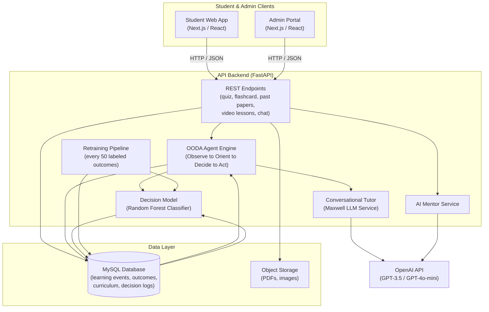
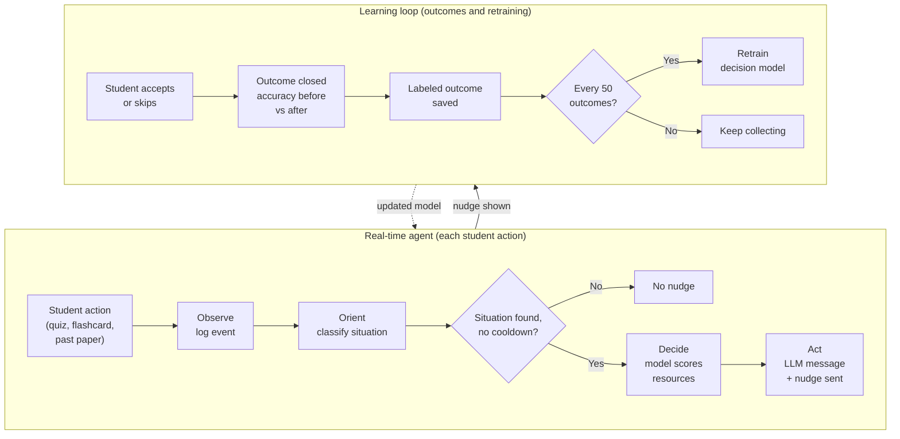

# Agentic Intelligent Tutoring System

An adaptive GCSE/A-Level tutoring platform that diagnoses student learning
states across multiple surfaces and automatically selects the most effective
intervention, without calling a language model for every decision.

*The nudge card: A proactive cognitive intervention card displaying the companion avatar, situational diagnosis, reasoning, and action buttons. (Thesis deployment)*

---

## Overview

Students revising for UK school exams rarely get timely, personalised
guidance. A textbook cannot detect when you have misunderstood the same
concept across three different practice formats. A generic quiz app cannot
decide whether you need a video rewatch, a flashcard session, or a Socratic
conversation.

Genius Hub gives students quizzes, spaced-repetition flashcards, video
lessons, and past exam papers on one platform. For my thesis, I designed and
evaluated an agentic tutoring layer that sits behind these surfaces: it
observes every student interaction, classifies the learning state, and
selects a targeted intervention. The ML and retraining work described in
this write-up was evaluated in a controlled simulation, not in the live
student application.

This is a case study write-up. The source code is private (see the note at
the bottom).

---

## System Architecture

The platform runs as four services under Docker Compose. A REST API backend
sits at the centre; it receives every student action and returns a response
that may include an intervention nudge alongside the normal quiz or
flashcard result.

### How a typical student session flows

1. A student submits a quiz answer. The grading endpoint returns the result
   immediately. In the same request, the agent's **Observe** step fires
   non-fatally (a failure never blocks grading). A learning event is written
   to the database: user, subtopic, correct or incorrect, surface type,
   timestamp.

2. **Orient**: the last ten events for that student and subtopic are pulled.
   Four situations are checked in priority order: retention failure (repeated
   flashcard struggles), weak streak (three or more consecutive wrong answers),
   misconception (wrong answers across two different surfaces, suggesting a
   deeper conceptual gap), and mastery confirmed (85% or higher accuracy). A
   15-minute cooldown per situation and a 60-second subtopic guard prevent
   over-nudging.

3. **Decide**: each situation maps to an ordered resource chain. The decision
   model scores every candidate by predicting the probability it will improve
   this student's accuracy. The highest-scoring resource is chosen. If the
   model has fewer than 50 labeled examples, it falls back to the first item
   in the chain.

4. **Act**: the LLM generates a short encouraging sentence (20 words or
   fewer). The API response includes a nudge payload with message text, action
   type, and interactive buttons. An outcome record is created to track what
   happens next.

5. When the student accepts or skips, a telemetry endpoint records the choice.
   Once at least four events have occurred after the suggestion, the outcome
   is closed: accuracy before vs. after is compared, and a "was helpful" label
   is assigned if accuracy improved by five or more percentage points. Every
   50 labeled outcomes, the model retrains automatically.

---

## Platform Surfaces and Interfaces

Most of the interface shown here was built by teammates. My work is the agent and ML layer behind it.

### Student Learning Surfaces

#### 1. Student Revision Dashboard

*Student Revision Dashboard: Syllabus completion rings, predicted grades, active diagnostic quests, and the 3D companion avatar. (Thesis deployment)*

The revision dashboard serves as the central hub, displaying syllabus completion rings, predicted grades, and active diagnostic remediation quests tracking student recovery.

---

#### 2. Adaptive Timed Quiz Surface

*Adaptive Timed Quiz Surface: Countdown timer, KaTeX formula rendering, instant answer grading, and hint support. (Thesis deployment)*

Submitting an answer evaluates the question immediately and invokes the agent's non-fatal Observe hook to log learning telemetry without delaying the response.

---

#### 3. Spaced Repetition Flashcards

*Spaced Repetition Flashcards: Active recall review with 3D flip animation, self-assessed confidence toggles, and generative AI variations. (Thesis deployment)*

Confidence ratings directly feed the 9-dimensional ML feature vector (specifically still-learning counts) used by the decision model during intervention ranking.

---

#### 4. Interactive Video Lessons & Checkpoints

*Interactive Video Lessons: Multimedia playback with embedded formative checkpoint prompts. (Live platform)*

Formative checkpoint questions appear at key timestamps to reinforce concepts and log learning events to detect conceptual friction.

---

#### 5. Split-Screen Past Exam Papers

*Split-Screen Past Exam Papers: Official PDF paper viewer paired with an error self-reporting checklist and conversational mentor drawer. (Thesis deployment)*

Students review authentic exam PDFs from cloud storage and report incorrect questions, triggering diagnostic remediation quests and mentor explanations.

---

#### 6. Conversational AI Mentors & 3D Avatar

*Conversational AI Mentors: Dual AI mentor chat (Jarvis and Professor Maxwell) with real-time 3D WebGL avatar canvas. (Live platform)*

Students interact with two mentoring personas (Jarvis for structured curriculum plans, Professor Maxwell for Socratic dialogue) alongside a 3D animated companion avatar.

---

Admin portal screenshots

### Administration Backoffice Portal

#### Curriculum Taxonomy Management

*Curriculum taxonomy manager organizing content across the 6-level hierarchy. (Live platform)*

#### LaTeX Question Bank Authoring Suite

*Question bank editor with real-time KaTeX formula preview, answer options, and cloud asset uploads. (Live platform)*

#### Automated Exam Package (ZIP) Ingestion

*Bulk ingestion tool verifying and importing past exam packages. (Live platform)*

#### User Cohort Analytics & Telemetry Supervision

*Administrative supervision dashboard tracking cohort activity, accuracy trends, active quests, and model retraining. (Thesis deployment)*

---

## Content Digitisation Pipeline (MinerU)

> **Note:** This pipeline is separate from the main platform codebase. It was
> an offline process I ran independently.

GCSE and A-Level past exam papers exist as scanned PDFs from various exam
boards. Getting that content into the platform as structured data (question
text, mark schemes, diagrams, subtopic mappings) by hand would not have been
practical at the scale needed.

I used [MinerU](https://github.com/opendatalab/MinerU), an open-source
document intelligence tool, as the OCR and layout-analysis engine. My
contribution was everything built around it:

- **Pre-processing**: preparing PDFs for clean ingestion.
- **Post-processing**: scripts to take MinerU's raw JSON output and normalise
  it into the platform's question schema (mapping question blocks to
  subtopics, cleaning formatting artefacts, separating diagrams from text).
- **Quality review**: manually checking parsed output before import. OCR
  errors on mathematical notation and diagrams were the main failure mode, so
  each paper's output was spot-checked.
- **Asset pipeline**: MinerU produces both JSON and extracted images. Both
  were uploaded to cloud object storage and then imported into the database.

**Volume**: dozens of past papers across multiple subjects and exam boards.

**Output format**: structured JSON mapping question content and mark scheme
answers to the platform's curriculum hierarchy, plus image assets served from
object storage to the past-paper viewer.

---

## Tech Stack

**Backend**
- Python, FastAPI, SQLAlchemy, Alembic, Pydantic
- MySQL
- JWT authentication, Argon2 password hashing

**ML / AI**
- scikit-learn (Random Forest classifier), NumPy, pandas
- OpenAI API: GPT-3.5-turbo (conversational tutor and agent nudge reasoning),
  GPT-4o-mini (AI Mentor)

**Infrastructure**
- Docker, Docker Compose (four services: database, backend, student frontend,
  admin portal)
- Oracle Cloud VM: thesis deployment and evaluation
- Vercel — main production hosting for the student and admin web apps
- Oracle Cloud Object Storage: PDFs, question diagrams

**Frontend** *(teammates' primary work)*
- Next.js, React, TypeScript, Material-UI, Three.js (3D animated companion
  avatar)

---

## My Role and Contributions

This was a team project built during an internship, final-year project, and
industrial placement at SELFTECH (August 2025 to September 2026). Below is
what I personally built.

**Designed and built by me**

- **OODA agent engine** — the full Observe, Orient, Decide, Act pipeline:
  event ingestion hooks across all four learning surfaces, the situation
  classifier (four states, priority ordering, anti-spam guardrails), resource
  chain resolution, nudge construction, and the diagnostic quest state machine
  that tracks each student's remediation journey from detection to mastery.
- **Decision model**: 9-feature vector engineering, Random Forest training
  logic, model serialisation, singleton in-memory caching for low-latency
  inference, and cold-start fallback behaviour.
- **Self-improving retraining pipeline** — outcome telemetry endpoint,
  reactive loop closing (accuracy delta computation, was-helpful labelling),
  automatic retraining at every 50-outcome milestone, and in-process model
  reload.
- **Docker setup**: multi-service Compose configuration, startup resilience
  (database connection retry logic), and environment isolation.
- **Database schema work** (including redesigning a significant hierarchy
  issue in the curriculum structure): resolved how content was organised
  across subjects, topics, and subtopics.
- **Content digitisation pipeline** — post-processing scripts around MinerU,
  quality review, and asset pipeline (described above).
- **Synthetic student simulation**: designed and ran the 200-student
  cognitive simulation (six archetypes, probabilistic response model based on
  ability, forgetting rate, fatigue, and session mood) to generate labeled
  training data before any real outcome data existed.

**Prototyped by me; teammates integrated and extended**

- The conversational tutor (Maxwell), AI Mentor, flashcard AI generation, and
  past-paper AI chat. I built the working prototypes of all the platform's AI
  features; the team built them into the full product.

**Extended and maintained (not the original author)**

- The FastAPI backend application. My manager set up the initial project
  structure; I did extensive development across multiple iterations on top of
  that foundation.

**Minor contribution**

- Some frontend work.

---

## Key Engineering Decisions

### 1. Use a lightweight ML model for intervention selection, not an LLM every time

**Problem**: each student interaction might trigger a decision about which
resource to suggest. Calling a language model synchronously on every quiz
answer adds latency, costs money at scale, and fails when the API is
unreachable.

**Options considered**: always call the LLM with the situation context and let
it choose; pure rule-based lookup (always pick the first item in the resource
chain); or train a lightweight classifier on historical intervention outcomes.

**Choice**: a Random Forest classifier that scores candidates from recorded
outcomes, with the LLM reserved only for generating the student-facing
reasoning sentence.

**Reasoning**: the classifier runs in milliseconds with no external call,
works without an API connection, is deterministic and auditable, and improves
as more outcomes are recorded. The LLM is still called, but only once per
decision for a short encouraging sentence, not to make the core choice.

**Trade-off**: the classifier cannot generalise beyond situations seen in
training. For the first 50 outcomes, the system falls back to rule-based
selection, so early decisions are less personalised.

---

### 2. Non-fatal agent hooks: the agent must never break the core product

**Problem**: an AI or ML failure during a quiz submission would be a poor
experience. The student just wants to know if they got the answer right.

**Choice**: every call to the agent is wrapped in an isolated error handler.
If anything in the OODA pipeline fails (a database timeout, an LLM API error,
a model deserialisation failure), the error is logged and the API returns a
null nudge. The quiz grading still completes normally.

**Reasoning**: reliability of the core product (grading, flashcards, progress
tracking) is a harder requirement than the agent. This pattern also lets the
agent be changed or broken in development without affecting the main user
experience.

**Trade-off**: silent agent failures are easy to miss in production without
active log monitoring.

---

### 3. Prevent semantic drift with a strict nudge contract

**Problem**: in a multi-model pipeline (ML chooses the resource, LLM generates
the message, frontend renders the buttons), each layer could describe a
different action. A student might receive a message saying "watch this video"
but get a "Do Flashcards" button, because the LLM reasoned from the situation
name while the button came from the ML's resolved choice.

**Choice**: once the ML resolves a resource type, all three outputs (message
template, action type, button labels) are derived from the same lookup table
keyed on that one value. The LLM generates only the reasoning sentence and
does not select or name the resource.

**Reasoning**: consistency is enforced as a system property, not a property of
LLM output. No amount of prompt engineering is as reliable as a deterministic
lookup. A regression test iterates through every resource type and asserts
that all three outputs match, so any future change that breaks this contract
fails a test immediately.

**Trade-off**: the message templates are somewhat formulaic. The LLM adds
warmth to the reasoning sentence but cannot change the core action described.

---

## ML Model and Retraining Pipeline

The decision model is a binary classifier. Given a student's current state
and a candidate intervention type, it predicts the probability that the
intervention will be helpful, specifically, that the student's accuracy on
the subtopic will improve by at least five percentage points over the next
four or more attempts.

**Input features (9 dimensions)**: recent subtopic accuracy, consecutive
failure count, total quiz sessions completed, total questions attempted across
all surfaces, count of "still-learning" flashcard attempts, encoded learning
style, motivation level, days since last activity, and encoded candidate
resource type.

**Algorithm**: Random Forest (100 trees, maximum depth 8, balanced class
weights to handle the imbalance between helpful and unhelpful interventions).

**Training data before any real outcome data existed**: 200 synthetic students
were simulated using six behavioural archetypes (high achiever, steady,
struggling, improving, inconsistent, crammer) with a probabilistic response
function accounting for latent ability, topic-specific skill, forgetting decay,
question difficulty, session fatigue, and emotional tilt from consecutive
misses. This generated the initial labeled dataset.

**How retraining works**: every new learning event triggers a check of open
outcome records. Once at least four events have occurred after a suggestion
was accepted, the outcome is closed and labeled. When labeled outcomes cross
the next multiple of 50, the classifier retrains from the full outcome table,
the updated model is serialised to disk, and the in-memory singleton is
refreshed with no manual trigger required. Retraining runs synchronously in
the request path, which is fine at this scale but would need to move to an
async worker in a larger system.

**Controlled simulation results**: ML-reranked policy achieved 71.85%
helpfulness vs. 58.40% for the fixed-rule baseline — a +13.45 percentage-point
difference on identical synthetic cohorts (N=100 per run). See the Results
section for the full breakdown.

---

## Challenges and How I Solved Them

### Cold-start: the classifier needs data, but must work before any data exists

Before any outcome data existed, the decision model had nothing to train on.
I addressed this with two approaches working together. First, a deterministic
fallback: whenever the model lacks sufficient labeled examples, the agent picks
the first resource in the situation's chain. Second, a synthetic student
simulation: I designed and ran a 200-student cognitive simulation using six
behavioural archetypes and a probabilistic response model (ability, forgetting
curve, fatigue, mood). This produced enough labeled outcomes for a defensible
initial training run, so the ML path worked from the first simulation run
rather than being blocked until real data accumulated.

### Keeping all three layers of the OODA decision in agreement

The pipeline chains three separate systems: the decision model selects a
resource type, the LLM generates a message, and the frontend renders buttons.
Early in development these could disagree: the LLM would mention videos while
the decision model had selected flashcards, because they were given different
inputs.

The fix was a strict output contract: the resolved resource type is the single
source of truth, and the message template, action type, and button labels are
all derived from a lookup keyed on that value. The LLM receives the resolved
resource and produces only a short encouraging sentence. A regression test
that iterates through every resource type and asserts that all three outputs
match catches any future breakage immediately.

### Getting the backend and database to start reliably inside Docker

The FastAPI application tries to connect to MySQL on startup. In a Docker
Compose environment, the database container can take several seconds to fully
initialise after reporting as running. Early in the project this caused the
backend to crash on startup and require a manual restart.

The fix was a retry loop in the database initialisation step: the application
attempts to connect up to 15 times with a two-second pause between attempts,
logs each failure with its attempt number, and raises only if all attempts are
exhausted. This made cold-start deploys reliable without needing external
health-check orchestration.

---

## Results

**Controlled simulation experiment** (synthetic cohorts, N=100 per run,
identical random seeds and archetypes, paired comparison):

| Metric | Fixed-rule baseline | ML-reranked policy | Delta |
|---|---|---|---|
| Helpfulness rate | 58.40% | 71.85% | +13.45 pp |
| Mean accuracy improvement per accepted intervention | +5.12 pp | +9.38 pp | +4.26 pp |

These results are from a controlled paired comparison on synthetic data, not
a live deployment. They validate the architecture and confirm the direction
of the effect; real-world figures would differ.

**Deployment**: the platform was deployed end-to-end on Oracle Cloud
Infrastructure and demonstrated to academic reviewers. The main student and
admin applications are live on Vercel.

---

## What I Would Do Differently

**Move retraining off the request path.** Running the classifier retrain
synchronously in the web request that triggers it adds unpredictable latency
as the outcome dataset grows. A production system would push this to an async
worker so the retraining never stalls a user-facing request.

**Add out-of-sample evaluation to the retraining loop.** The current pipeline
logs training accuracy but has no held-out validation set. Without one, there
is no reliable signal that each new model generation is better than the
previous one. I would hold out 20% of outcomes per cycle and gate deployment
on validation performance above a threshold.

**Add sequence-aware situation detection.** The current feature set treats
the student as a bag of aggregated statistics with no memory of event order.
A sequence-aware representation of recent events would let the system detect
subtler patterns (for example, a student who alternates correct and incorrect
answers on the same question, which looks like moderate accuracy in aggregate
but is actually oscillating confusion).

**Harden the production environment sooner.** The Oracle Cloud deployment ran
development servers, which was fine for a thesis demo. A production version
would use a production WSGI server with multiple workers, optimised frontend
builds, a reverse proxy with HTTPS, and proper secret management.

---
## Scope and Status

The OODA agent, decision model, and retraining pipeline are my thesis work.
I built and evaluated them in a separate Oracle Cloud deployment, and they are
not yet part of the live student app. The surrounding platform (quizzes,
flashcards, past papers, admin portal) runs on Vercel. Results in this
write-up come from a controlled simulation, not from live student data.

## Note on Source Code

This repository contains only the case study documentation. The full source
code is team and company work produced during an internship and final-year
project at SELFTECH. It is held in a private repository. I have permission to
publish this high-level architectural write-up; no source code, configuration
values, secrets, or student data are included here.
