# Agentic Intelligent Tutoring System
### Case study: the agent layer of Genius Hub

A student gets the same concept wrong in a quiz, a flashcard, and a past paper, and nothing notices. This project is an agent that does, and decides what they should do next.

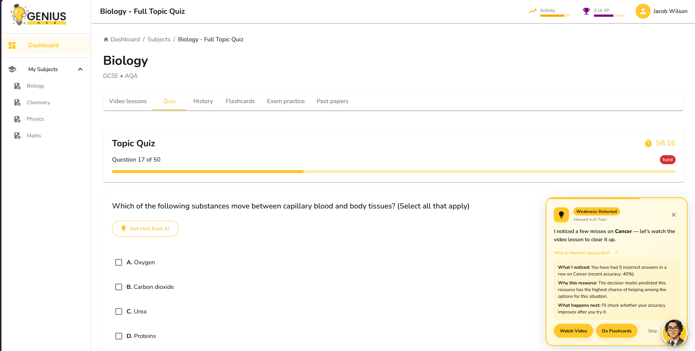
*The nudge card: a proactive intervention card showing the companion avatar, the agent's diagnosis, its reasoning, and action buttons. (Thesis deployment)*

> Documentation-only case study. The source code is private (see the note at the bottom).

---
## The Platform

Genius Hub is a full GCSE/A-Level revision product built by a team. Students get:

- Timed quizzes with instant grading and formula rendering
- Spaced-repetition flashcards with AI-generated variations
- Video lessons with in-video checkpoint questions
- Split-screen past exam papers with error self-reporting
- AI tutor named professor Maxwell.

Behind it, an admin portal manages the curriculum hierarchy, the question bank, and bulk import of exam papers. The backend is a FastAPI service with a MySQL database, and the whole system runs as four Docker Compose services. The agent described below is one layer of this platform, and the one I designed and built for my thesis.

## The Problem and What I Built

Students revising for UK school exams rarely get timely, personalised guidance. A textbook can't tell that you've misunderstood the same concept in three different practice formats. A generic quiz app can't decide whether you need a video, a flashcard session, or a conversation with a tutor.

Genius Hub is a GCSE/A-Level revision platform with quizzes, spaced-repetition flashcards, video lessons, and past exam papers. For my thesis, I designed and built an agentic layer behind those surfaces. It watches every student interaction, works out where the student is stuck, and picks the most effective next step using a lightweight ML model (not an LLM call per decision). It then checks whether that step helped and retrains itself on the results.

I evaluated this layer in a controlled simulation, not in the live student application (see Scope and Status at the bottom).

---
## System Architecture

The platform runs as four services under Docker Compose. A REST API backend
sits at the centre; it receives every student action and returns a response
that may include an intervention nudge alongside the normal quiz or
flashcard result.

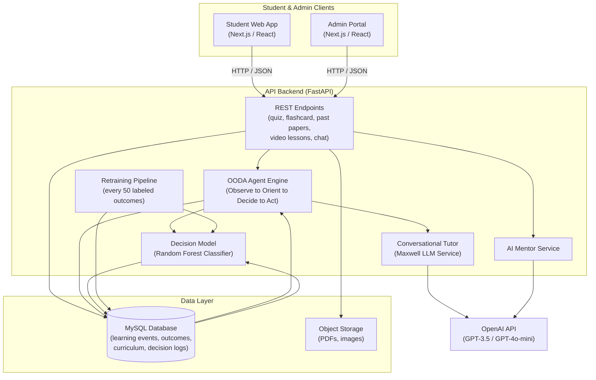

### How a typical student session flows

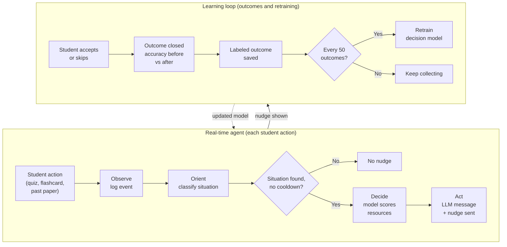

1. A student submits a quiz answer. The grading endpoint returns the result
   immediately. In the same request, the agent's **Observe** step fires
   non-fatally (a failure never blocks grading). A learning event is written
   to the database: user, subtopic, correct or incorrect, surface type,
   timestamp.

2. **Orient**: the last ten events for that student and subtopic are pulled.
   Four situations are checked in priority order: retention failure (repeated
   flashcard struggles), weak streak (three or more consecutive wrong answers),
   misconception (wrong answers across two different surfaces, suggesting a
   deeper conceptual gap), and mastery confirmed (85% or higher accuracy). A
   15-minute cooldown per situation and a 60-second subtopic guard prevent
   over-nudging.

3. **Decide**: each situation maps to an ordered resource chain. The decision
   model scores every candidate by predicting the probability it will improve
   this student's accuracy. The highest-scoring resource is chosen. If the
   model has fewer than 50 labeled examples, it falls back to the first item
   in the chain.

4. **Act**: the LLM writes one short, encouraging message. The API response
   includes a nudge payload with the message, action type, interactive
   buttons, and an expandable explanation. An outcome record is created to
   track what happens next.

5. When the student accepts or skips, a telemetry endpoint records the choice.
   Once at least four events have occurred after the suggestion, the outcome
   is closed: accuracy before vs. after is compared, and a "was helpful" label
   is assigned if accuracy improved by five or more percentage points. Every
   50 labeled outcomes, the model retrains automatically.

---

## Platform Surfaces and Interfaces

Most of the interface shown here was built by teammates. My work is the agent and ML layer behind it.

### Student Learning Surfaces

#### 1. Student Revision Dashboard
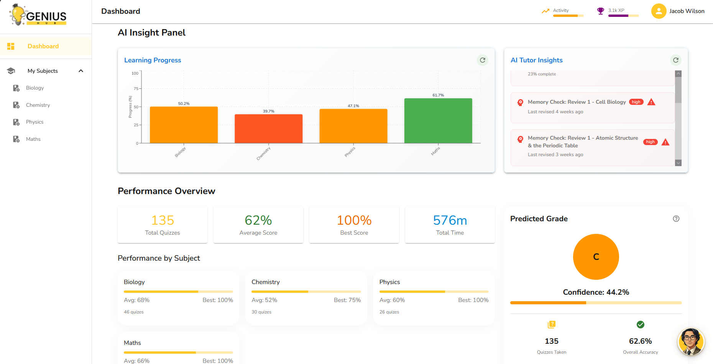
*Student Revision Dashboard: Syllabus completion rings, predicted grades, active diagnostic quests, and the 3D companion avatar. (Thesis deployment)*

The revision dashboard serves as the central hub, displaying syllabus completion rings, predicted grades, and active diagnostic remediation quests tracking student recovery.

---

#### 2. Adaptive Timed Quiz Surface
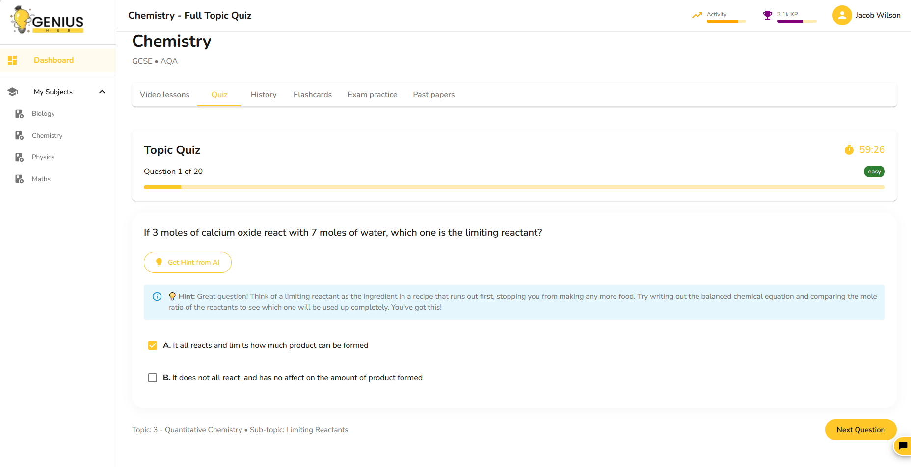
*Adaptive Timed Quiz Surface: Countdown timer, KaTeX formula rendering, instant answer grading, and hint support. (Thesis deployment)*

Submitting an answer evaluates the question immediately and invokes the agent's non-fatal Observe hook to log learning telemetry without delaying the response.

---

#### 3. Spaced Repetition Flashcards
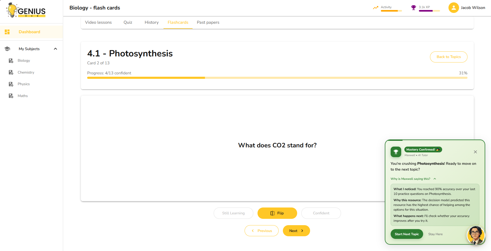
*Spaced Repetition Flashcards: Active recall review with 3D flip animation, self-assessed confidence toggles, and generative AI variations. (Thesis deployment)*

Confidence ratings directly feed the 9-dimensional ML feature vector (specifically still-learning counts) used by the decision model during intervention ranking.

---

#### 4. Interactive Video Lessons & Checkpoints
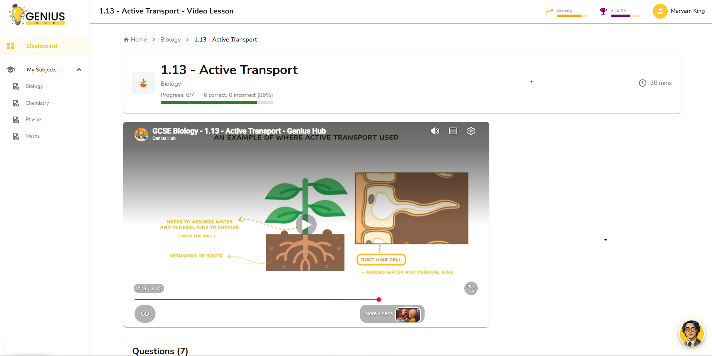
*Interactive Video Lessons: Multimedia playback with embedded formative checkpoint prompts. (Live platform)*

Formative checkpoint questions appear at key timestamps to reinforce concepts and log learning events to detect conceptual friction.

---

#### 5. Split-Screen Past Exam Papers
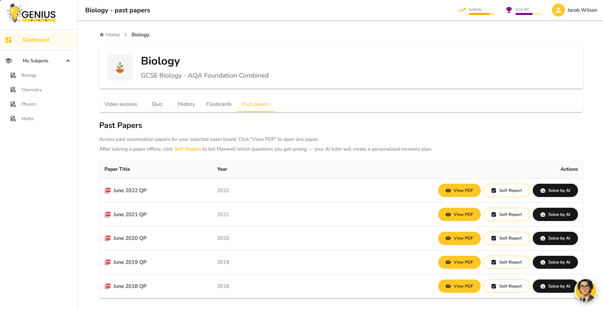
*Split-Screen Past Exam Papers: Official PDF paper viewer paired with an error self-reporting checklist and conversational mentor drawer. (Thesis deployment)*

Students review authentic exam PDFs from cloud storage and report incorrect questions, triggering diagnostic remediation quests and mentor explanations.

---

#### 6. Conversational AI Mentors & 3D Avatar
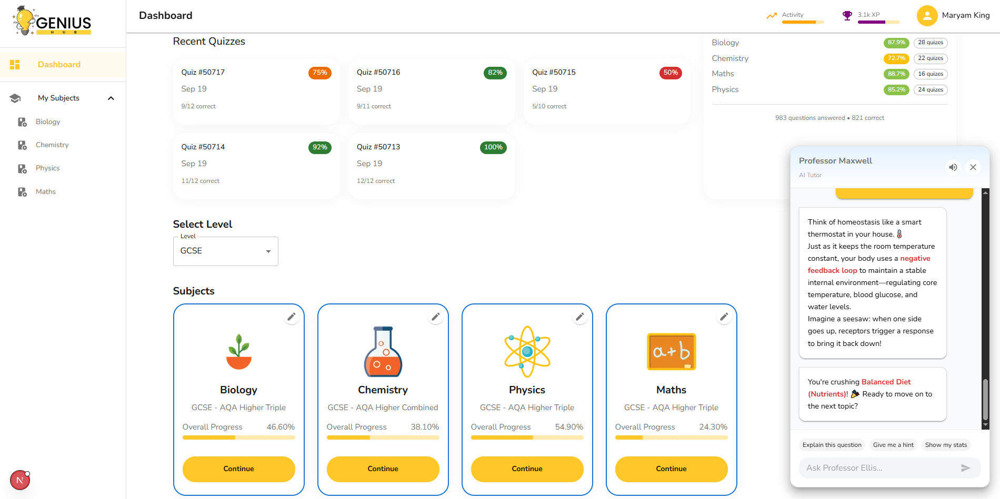
*Conversational AI Mentors: AI mentor chat with a real-time 3D WebGL avatar canvas. (Live platform)*

Students chat with a mentoring persona (Professor Maxwell) alongside a 3D animated companion avatar.

---

### Admin Portal

#### Curriculum Taxonomy Manager
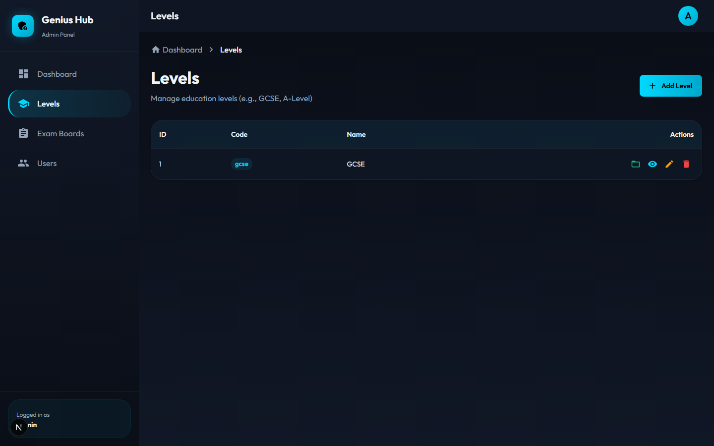
*Content organised across qualification level, subject, exam board, module, topic, and subtopic. (Live platform)*

#### Question Bank Editor
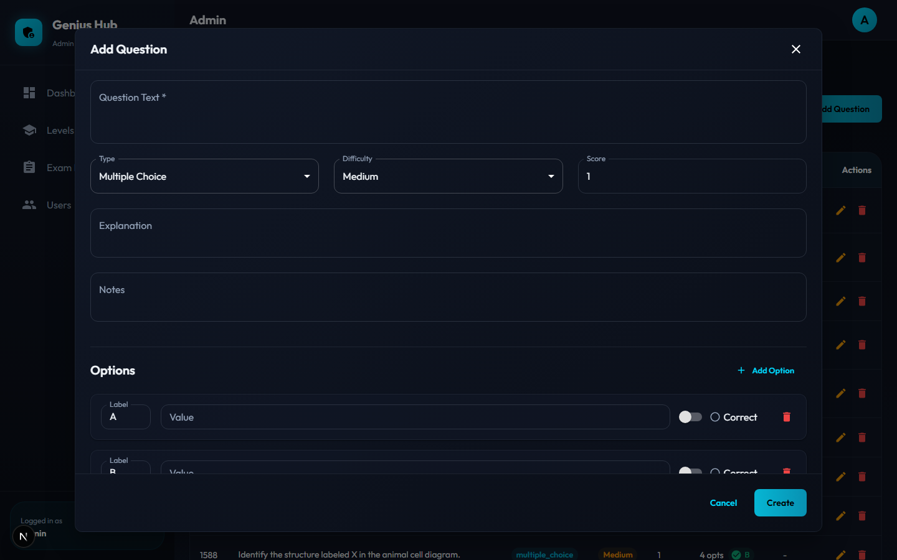
*Live formula preview, answer options, and diagram uploads to cloud storage. (Live platform)*

#### Exam Package Ingestion
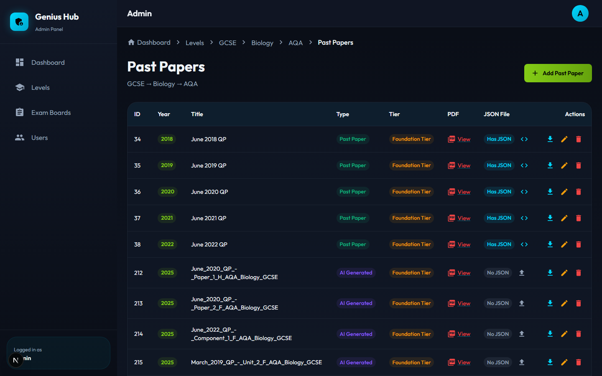
*Bulk import of past exam papers. (Live platform)*

#### Cohort Analytics
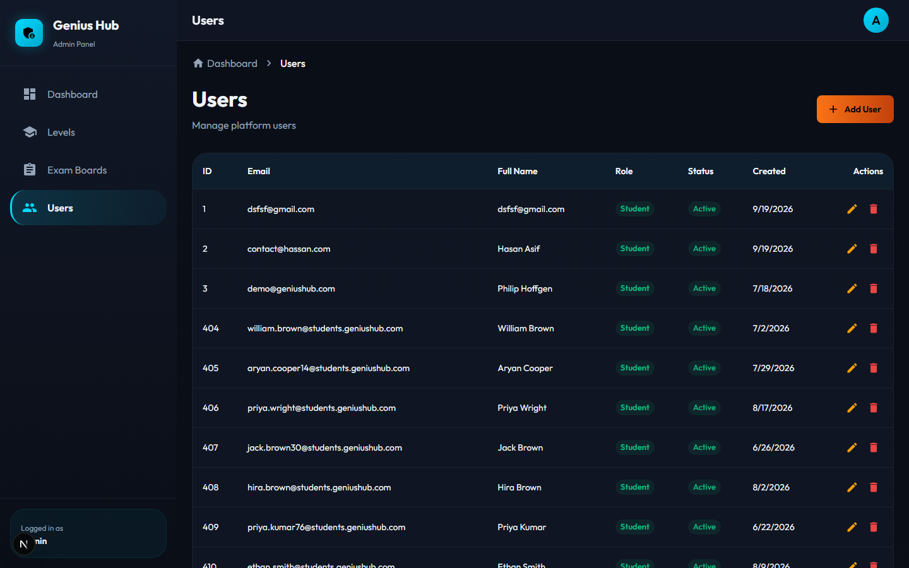
*Cohort activity, accuracy trends, active quests, and model retraining. (Thesis deployment)*

---

## My Role and Contributions

This was a team project built during an internship, final-year project, and
industrial placement at SELFTECH (August 2025 to September 2026). Here is
what I personally did.

**Designed and built by me**

- **OODA agent engine:** the full Observe, Orient, Decide, Act pipeline:
  event hooks across all four learning surfaces, the situation classifier
  (four states, priority ordering, anti-spam guardrails), resource selection,
  nudge construction, and the diagnostic quest state machine that tracks each
  student's recovery from detection to mastery.
- **Decision model:** 9-feature input design, Random Forest training, model
  serialisation, in-memory caching for low-latency inference, and cold-start
  fallback behaviour.
- **Self-improving retraining pipeline:** outcome tracking, accuracy-delta
  labelling, automatic retraining every 50 labeled outcomes, and in-process
  model reload.
- **Synthetic student simulation:** a 200-student simulation (six archetypes,
  probabilistic response model based on ability, forgetting rate, fatigue, and
  session mood) used to generate labeled training data and run the evaluation.
- **Docker setup:** multi-service Compose configuration, startup resilience
  (database connection retry logic), and environment isolation.
- **Database schema work**, including redesigning a significant hierarchy
  issue in how content was organised across subjects, topics, and subtopics.

**AI features: prototyped by me, built into the platform with the team**

- The conversational tutor (Maxwell), AI Mentor, flashcard AI generation, and
  past-paper AI chat. I built the original working prototypes and then worked
  on bringing them into the live product, where teammates also extended them.
  
**Extended and maintained (not the original author)**

- The FastAPI backend application. My manager set up the initial project
  structure; I did extensive development across multiple iterations on top of
  that foundation.

**Minor contribution**

- Some frontend work.

---

## Key Engineering Decisions

### 1. Use a lightweight ML model for intervention selection, not an LLM every time

**Problem**: each student interaction might trigger a decision about which
resource to suggest. Calling a language model synchronously on every quiz
answer adds latency, costs money at scale, and fails when the API is
unreachable.

**Options considered**: always call the LLM with the situation context and let
it choose; pure rule-based lookup (always pick the first item in the resource
chain); or train a lightweight classifier on historical intervention outcomes.

**Choice**: a Random Forest classifier that scores candidates from recorded
outcomes, with the LLM used only to write a short student-facing message.

**Reasoning**: the classifier runs locally with no network call, keeps
working when the LLM API is down, is deterministic and auditable, and
improves as more outcomes are recorded. The LLM is still called, but only
once per nudge to phrase a short message, not to make the core choice.

**Trade-off**: the classifier cannot generalise beyond situations seen in
training. For the first 50 outcomes, the system falls back to rule-based
selection, so early decisions are less personalised.

---

### 2. Non-fatal agent hooks: the agent must never break the core product

**Problem**: an AI or ML failure during a quiz submission would be a poor
experience. The student just wants to know if they got the answer right.

**Choice**: every call to the agent is wrapped in an isolated error handler.
If anything in the OODA pipeline fails (a database timeout, an LLM API error,
a model deserialisation failure), the error is logged and the API returns a
null nudge. The quiz grading still completes normally.

**Reasoning**: reliability of the core product (grading, flashcards, progress
tracking) is a harder requirement than the agent. This pattern also lets the
agent be changed or broken in development without affecting the main user
experience.

**Trade-off**: silent agent failures are easy to miss in production without
active log monitoring.

---

### 3. Prevent semantic drift with a strict nudge contract

**Problem**: in a multi-model pipeline (ML chooses the resource, LLM generates
the message, frontend renders the buttons), each layer could describe a
different action. A student might receive a message saying "watch this video"
but get a "Do Flashcards" button, because the LLM reasoned from the situation
name while the button came from the ML's resolved choice.

**Choice**: once the model (or fallback rule) resolves a resource type, the
action type, button labels, and explanation text are all derived from the same
lookup keyed on that one value. The LLM is told which resource was chosen and
only phrases the short message. The explanation also says whether the trained
model or the fallback rule made the choice, and it never claims a prediction
when the fallback was used.

**Reasoning**: consistency of the action, buttons, and explanation is enforced
by the system, not left to LLM output. A regression test iterates through every
resource type and asserts that these outputs match, so any future change that
breaks the contract fails a test immediately.

**Trade-off**: the explanation text is templated, so it reads formulaic. The
LLM-written message is the one piece not enforced by the lookup, so it is
instructed to mention only the chosen resource.

---

### 4. Make the backend survive a slow database start

**Problem**: in Docker Compose, the MySQL container can take several seconds to
be ready after it reports as running. Early on, the backend crashed at startup
and needed a manual restart.

**Choice**: a retry loop in database initialisation: up to 15 attempts, two
seconds apart, logging each failure with its attempt number, and raising only
if all attempts fail.

**Why**: it made cold-start deploys reliable without extra orchestration or
health-check tooling.

## ML Model and Retraining Pipeline

The decision model is a binary classifier. Given a student's current state
and a candidate intervention type, it predicts the probability that the
intervention will be helpful, specifically, that the student's accuracy on
the subtopic will improve by at least five percentage points over the next
four or more attempts.

**Input features (9 dimensions)**: recent subtopic accuracy, consecutive
failure count, total quiz sessions completed, total questions attempted across
all surfaces, count of "still-learning" flashcard attempts, encoded learning
style, motivation level, days since last activity, and encoded candidate
resource type.

**Algorithm**: Random Forest (100 trees, maximum depth 8, balanced class
weights to handle the imbalance between helpful and unhelpful interventions).

**Training data before any real outcome data existed**: 200 synthetic students
were simulated using six behavioural archetypes (high achiever, steady,
struggling, improving, inconsistent, crammer) with a probabilistic response
function accounting for latent ability, topic-specific skill, forgetting decay,
question difficulty, session fatigue, and emotional tilt from consecutive
misses. This generated the initial labeled dataset.

**How retraining works**: every new learning event triggers a check of open
outcome records. Once at least four events have occurred after a suggestion
was accepted, the outcome is closed and labeled. When labeled outcomes cross
the next multiple of 50, the classifier retrains from the full outcome table,
the updated model is saved, and the in-memory copy is refreshed with no manual
trigger required.

---

## Results

**Controlled simulation experiment** (synthetic cohorts, N=100 per run,
identical random seeds and archetypes, paired comparison):

| Metric | Fixed-rule baseline | ML-reranked policy | Delta |
|---|---|---|---|
| Helpfulness rate | 58.40% | 71.85% | +13.45 pp |
| Mean accuracy improvement per accepted intervention | +5.12 pp | +9.38 pp | +4.26 pp |

These results are from a controlled paired comparison on synthetic data, not
a live deployment. They validate the architecture and confirm the direction
of the effect; real-world figures would differ.

**Deployment**: the platform was deployed end-to-end on Oracle Cloud
Infrastructure and demonstrated to academic reviewers. The main student and
admin applications are live on Vercel.

---
## What I Would Do Differently

- **Move retraining off the request path.** Retraining runs inside the web request that triggers it. That's fine at this scale, but latency would grow with the dataset. A production system would hand it to an async worker.
- **Evaluate each new model before using it.** The pipeline logs training accuracy but has no held-out validation set, so there's no reliable signal that a new model beats the previous one. I would hold out part of the outcomes each cycle and only deploy a model that passes a threshold.
- **Detect patterns over time.** The current features are aggregated statistics with no memory of event order. A sequence-aware approach could catch patterns like alternating right and wrong answers, which look like moderate accuracy in aggregate but signal oscillating confusion.
- **Harden the deployment.** The thesis deployment ran development servers. A production version would use a proper ASGI server (for example Gunicorn with Uvicorn workers) with multiple workers, optimised builds, HTTPS behind a reverse proxy, and managed secrets.

---

## Tech Stack

**Backend:** Python, FastAPI, SQLAlchemy, Alembic, Pydantic, MySQL, JWT authentication, Argon2 password hashing

**ML / AI:** scikit-learn (Random Forest), NumPy, pandas; OpenAI API (GPT-3.5-turbo for the conversational tutor and nudge message, GPT-4o-mini for the AI Mentor)

**Infrastructure:** Docker and Docker Compose (database, backend, student frontend, admin portal); Oracle Cloud VM (thesis deployment); Oracle Cloud Object Storage (PDFs, diagrams); Vercel (student and admin web apps)

**Frontend** *(teammates' primary work)*: Next.js, React, TypeScript, Material-UI, Three.js

---

## Scope and Status

The OODA agent, decision model, and retraining pipeline are my thesis work. I built and evaluated them in a separate Oracle Cloud deployment, and they are not yet part of the live student app. The surrounding platform (quizzes, flashcards, past papers, admin portal) runs on Vercel. Results in this write-up come from a controlled simulation, not from live student data.

## Note on Source Code

This repository contains only the case study documentation. The full source code is team and company work produced during an internship and final-year project at SELFTECH, and it is held in a private repository. I have permission to publish this high-level write-up. No source code, configuration values, secrets, or student data are included.
