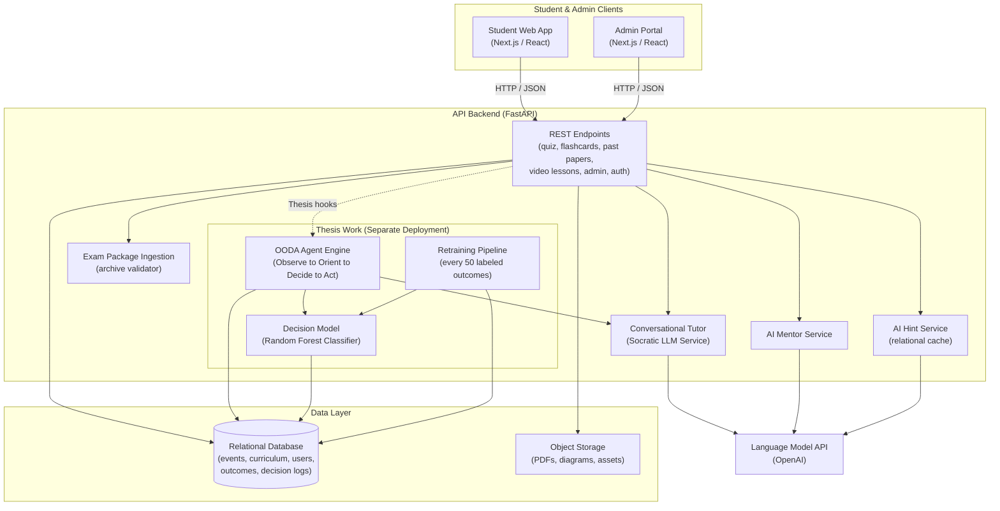
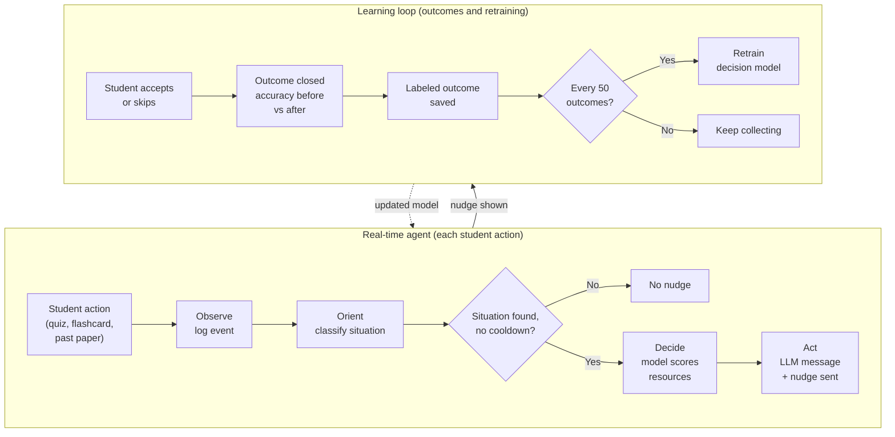

# Revision Platform and Agentic Tutoring System
### Case study: Industrial learning platform, backend engineering, and thesis AI agent layer

A GCSE and A-Level revision platform with timed quizzes, spaced flashcards, video lessons, and past papers. I contributed to backend engineering across the platform and designed an autonomous AI agent layer as my thesis to guide struggling students.

*Student revision dashboard showing syllabus completion rings, predicted grades, active diagnostic quests, and the companion avatar. (Thesis deployment)*

> Documentation-only case study. The source code is private (see the note at the bottom).

---

## The Platform

The platform is an industrial project developed with a team to help UK students prepare for GCSE and A-Level examinations across timed quizzes, spaced flashcards, video lessons, split-screen past papers, and conversational mentoring. For administrators, it provides curriculum management, LaTeX question authoring, bulk exam package ingestion, and student cohort analytics.

| Surface | Target User | Capabilities | Environment |
|---|---|---|---|
| Dashboard | Student | Syllabus completion rings, grade predictions, diagnostic quests | Live platform (quests in thesis deployment) |
| Timed Quizzes | Student | Formula rendering, instant answer grading, on-demand hints | Live platform |
| Flashcards | Student | Spaced repetition intervals, confidence ratings, generative variations | Live platform |
| Video Lessons | Student | Video playback with embedded checkpoint questions | Live platform |
| Past Exam Papers | Student | Split-screen document viewer, mark schemes, self-reported error tracking | Live platform |
| Socratic Mentors | Student | Conversational tutoring, revision advice, 3D companion avatar | Live platform |
| Curriculum Manager | Admin | Syllabus management across subjects, exam boards, and tiers | Live platform |
| Question Bank | Admin | LaTeX authoring, formula preview, cloud diagram uploads | Live platform |
| Package Ingestion | Admin | Bulk archive extraction and cloud asset processing | Live platform |
| Cohort Telemetry | Admin | Accuracy trends, active diagnostic quests, model retraining status | (Thesis deployment) |

This was an industrial project built with a team at SELFTECH. My manager created the initial FastAPI project structure, teammates built most of the frontend and admin user interfaces, and I developed domain services, data models, and data pipelines across the platform. The agent layer is my thesis work. It runs in a separate deployment and is not live for students.

---

## Platform Architecture

The platform runs as four containerized services orchestrated by Docker Compose: relational database, backend API, student web application, and admin portal.

- **Services**: Four isolated containers on an internal network, exposing client applications while shielding the database.
- **Data Layer**: A relational database stores curriculum structures, question banks, and learning events. Cloud object storage hosts past paper documents and question diagrams.
- **Deployment**: The live platform runs on Vercel with cloud databases and object storage. The thesis agent loop and evaluation harness run in a separate cloud virtual machine.

---

## My Role

This was an industrial project built with a team during an internship, final-year project, and placement at SELFTECH (August 2025 to September 2026). Here is what I personally designed and built across two main areas:

### Part A: Backend and Platform Engineering

- **Backend architecture**: My manager created the initial project structure. Teammates built most of the student frontend and admin portal. I built domain services, data models, and API endpoints across the platform.
- **Relational schema design**: Redesigned curriculum entities to decouple subjects from exam boards and tiers, preventing cross-board collisions. Authored schema migrations for events, sessions, hints, and decision outcomes.
- **Modular REST endpoints**: Built endpoints for adaptive quizzes, flashcard progress, past paper document navigation, syllabus analytics, grade prediction, and administrative management.
- **Database seeders**: Engineered idempotent seeding pipelines for curriculum taxonomies, LaTeX questions, past paper files, and synthetic student cohorts.
- **Content ingestion pipeline**: Built archive ingestion endpoints that validate uploaded exam packages in sandboxed directories and stream assets to cloud object storage.
- **On-demand hint caching**: Built a database-backed hint caching service to eliminate redundant language model requests and lower operating costs.
- **Cold-start connection resilience**: Configured container orchestration and built a startup retry loop to handle database initialization delays.
- **AI feature prototypes**: Prototyped the conversational tutor, AI mentor, generative flashcard variations, and past-paper discussion endpoints, then helped bring them into the live platform with the team.

### Part B: The AI Agent Layer (Thesis Work)

- **OODA agent engine**: Designed the Observe, Orient, Decide, Act pipeline with multi-surface event observation, priority-based situation classification, and anti-fatigue cooldown guards.
- **Decision model**: Engineered a 9-feature student state vector and trained a Random Forest classifier to select interventions based on predicted improvement probability.
- **Closed-loop retraining**: Built reactive outcome evaluation windowing and an automated retraining pipeline triggered at every 50 labeled outcomes.
- **Synthetic cohort simulation**: Built a 200-student simulation across six behavioral archetypes to generate training data and validate policy performance.
- **Thesis deployment**: Evaluated the agent in a dedicated cloud deployment, keeping it separate from the live platform.

---

## Backend and Platform Engineering

While the AI agent formed my thesis research, the platform required solid backend engineering across routing, relational data modeling, automated seeders, and container orchestration.

### 1. Modular API Architecture and Assessment Mechanics

The backend API is built with FastAPI and organized into domain route modules, Pydantic schemas, and decoupled services. Database sessions are injected per request, ensuring proper lifecycle management and query scoping.

- **Adaptive Quiz Engine**: Supports quiz session resumption. Submissions record student response times and correctness, immediately returning scores and diagnostic feedback upon completion.
- **Spaced Flashcards and Past Papers**: Endpoints manage active recall transitions between confident and still-learning states. Past paper endpoints support split-screen document viewing, mark schemes, and self-reported student error tracking.
- **Progress and Analytics**: Aggregation services compute topic completion percentages, rolling accuracy trends, and grade predictions.
- **Admin and Backoffice**: Endpoints support curriculum taxonomy manipulation, LaTeX question authoring with cloud diagram uploads, bulk past paper archive ingestion, and user cohort management.
- **Authentication and Role Guards**: Stateless token verification using JSON Web Tokens with Argon2 password hashing. Dependency-injected guards verify tokens, resolve identities, and enforce role separation between students and administrators. Requests with missing or invalid tokens are rejected with unauthorized status codes.

### 2. Relational Database Architecture and Domain Modeling

The database runs on a relational MySQL engine, using normalized entities to separate curriculum structure, assessment content, student state, and telemetry.

- **Curriculum Hierarchy**: Topics and subtopics attach to an intermediate exam board configuration (qualification level, subject, board, tier, course specification) instead of directly to the subject, so syllabi from different boards can coexist. See Key Engineering Decisions, #1.
- **Assessment and Asset Models**: Relational entities govern questions, LaTeX expressions, answer options, diagram image references, and past paper records. A hint service stores generated hints in the database (see Key Engineering Decisions, #3).
- **Unified Learning Event Stream**: An append-only telemetry stream records student actions across quizzes, flashcards, video checkpoints, and past papers. Each record captures the student identifier, event type, subtopic, question reference, correctness, and context metadata. This centralized stream serves as the data foundation for progress tracking and agent diagnosis.
- **Progress Snapshots**: Models track per-student topic completion, rolling accuracy, and total answered questions across subjects.

### 3. Automated Database Seeders and Data Pipelines

To eliminate cold-start data gaps and support reproducible development without manual data entry, I built a suite of idempotent database seeders.

- **Curriculum Taxonomy Seeders**: Populate UK GCSE and A-Level syllabi across major exam boards, creating complete hierarchical trees of subjects, modules, topics, and subtopics.
- **Question Bank Seeders**: Ingest curriculum questions with LaTeX formulas, multiple-choice options, and cloud diagram references.
- **Past Exam Paper Ingestion with Checkpointing**: Index past paper documents and structured question papers mapped to cloud storage. State checkpoints allow bulk imports to resume seamlessly if an upload is interrupted.
- **Causal Synthetic Student Cohorts**: Generates realistic student profiles and study logs. The generation model accounts for latent ability, practice gains, forgetting decay, question difficulty, and session fatigue. This produces realistic variance across student cohorts to validate analytics dashboards and agent behavior.
- **Idempotent Execution**: Seeders verify existing records before inserting new rows, allowing developers to reset or re-run environments safely without creating duplicate records.

### 4. Content Ingestion and Cloud Asset Pipeline

Entering complete past papers with mathematical formulas and diagrams through web forms was slow and error-prone. I built an administrative ingestion endpoint that processes structured archives.

The service accepts an uploaded ZIP archive, extracts it into a sandboxed temporary directory, and verifies that it contains exactly one structured paper definition file alongside any optional diagram assets. The pipeline organizes asset paths by qualification level, subject, exam board, and paper title, then streams the diagrams and definition file to cloud object storage. Finally, the service creates or updates the database record within a database transaction, rolling back changes and cleaning up temporary files if validation or upload fails.

### 5. Multi-Surface Progress and Grade Prediction

Student activity was originally tracked in separate feature tables. I built aggregation services to consolidate activity into progress and grade estimates.

- **Grade Boundary Mapping**: Translates overall student accuracy into standard UK GCSE and A-Level letter grades (A* through E) using official grade boundary thresholds and a confidence curve based on completed assessment volume.
- **Subject Completion Aggregation**: Combines video lesson checkpoints, flashcard intervals, and quiz accuracy into consolidated subject completion rings for the student dashboard.

### 6. Container Setup and Cold-Start Reliability

The platform runs in Docker Compose (database, backend, student frontend, admin portal). I added a startup retry loop so the backend waits for the database to accept connections. See Key Engineering Decisions, #2.

### 7. Thesis Deployment vs. Live Platform

The platform operates across two separate environments:

- **Live Platform**: The student web application and admin portal are deployed on Vercel with cloud databases and object storage for fast global content delivery.
- **Thesis Deployment**: To evaluate the agent without impacting real students, I deployed the complete containerized stack on a dedicated cloud virtual machine, running the synthetic simulation harness, the live OODA loop, and the empirical test suite.

---

## The AI Agent (Thesis Work)

The core focus of my thesis was designing and evaluating an autonomous agent layer that intervenes when a student struggles across revision surfaces.

*The nudge card: a proactive intervention card showing the companion avatar, the agent's diagnosis, its reasoning, and action buttons. (Thesis deployment)*

### The Problem

A student can fail a concept in a timed quiz, struggle on that same concept in a flashcard session, and miss it again on a past exam paper. Standard revision apps treat each attempt in isolation. The agent monitors interactions across surfaces, diagnoses underlying learning difficulties, and recommends the next best pedagogical step.

### How the Agent Works: The OODA Loop

The agent is organized around Boyd's OODA loop (Observe, Orient, Decide, Act), combining rule-based pedagogical bounds with machine learning reranking:

1. **Observe**: Non-fatal event hooks log student interactions across quizzes, flashcards, video checkpoints, and past papers into the telemetry stream. Because these hooks run inside error-handling wrappers, any agent failure returns an empty nudge without interrupting core grading or student navigation.
2. **Orient**: The engine queries recent events (up to 10 events) on the active subtopic and classifies the student's cognitive state using a prioritized hierarchy:
   - *Retention failure*: Multiple recent flashcards marked as still learning on the active subtopic.
   - *Weak streak*: Three or more consecutive incorrect attempts.
   - *Misconception*: Two or more incorrect attempts occurring across two or more distinct revision surfaces, signaling a flawed conceptual model rather than a slip.
   - *Mastery confirmed*: Accuracy reaches or exceeds 85% over five or more events, triggering prompts for advanced challenges or next-topic unlocks.
   - *Cooldown guards*: A 15-minute cooldown for identical situations and a 60-second subtopic guard prevent student alert fatigue.
3. **Decide**: Each situation defines an educational resource chain listing candidate interventions (such as video lessons, targeted videos, flashcard sessions, quizzes, past paper questions, or conversational mentor chats).
   - *Machine learning reranking*: A Random Forest classifier evaluates candidate resources against the student's profile and behavioral state, selecting the resource with the highest predicted probability of student improvement.
   - *Cold-start fallback*: If fewer than 50 labeled outcomes exist, the system safely falls back to the first item in the predetermined resource chain.
4. **Act**: The engine builds a nudge payload containing a short, encouraging message written by a language model, the action type, interactive buttons, and a templated explanation. It records an audit log, posts the suggestion to the student's conversational mentor feed, and creates an outcome tracking record initialized with baseline accuracy. It also creates or updates a multi-step diagnostic quest tracking the student toward an 85% mastery threshold.
5. **Learning Loop**: When the student accepts or skips the intervention, their response is recorded. As the student answers subsequent questions on that subtopic, the engine monitors performance. Once at least four subsequent events accumulate, the engine computes accuracy improvement. If accuracy improves by five percentage points or more, the outcome is labeled helpful. Every 50 labeled outcomes, the classifier retrains automatically on the updated dataset.

### The Decision Model

The decision model is a binary Random Forest classifier configured with 100 estimators, a maximum tree depth of 8, and balanced class weights. Given a student's state vector and a candidate intervention, it predicts whether the student's subtopic accuracy will improve by at least five percentage points over subsequent attempts.

**Input features (9 dimensions)**: recent subtopic accuracy, consecutive failure count, total completed quiz sessions, total questions attempted across surfaces, count of flashcards in the still-learning state, encoded learning style, motivation score, days since last activity, and encoded candidate resource identifier.

### Synthetic Simulation and Evaluation

To evaluate the decision model before live student deployment, 200 synthetic students were simulated using six behavioral archetypes: high achiever, steady, struggling, improving, inconsistent, and crammer. Student responses were generated using a cognitive response model incorporating latent ability, practice gains, forgetting curves, question difficulty, session fatigue, and failure streaks.

**Controlled simulation experiment** (synthetic cohorts, N=100 per run, identical random seeds and archetypes, paired comparison):

| Metric | Fixed-rule baseline | ML-reranked policy | Delta |
|---|---|---|---|
| Helpfulness rate | 58.40% | 71.85% | +13.45 pp |
| Mean accuracy improvement per accepted intervention | +5.12 pp | +9.38 pp | +4.26 pp |

These results are from a controlled paired comparison on synthetic data, not a live deployment. They validate the architecture and confirm the direction of the effect; real-world figures would differ.

---

## Key Engineering Decisions

### 1. Redesign curriculum hierarchy to decouple subjects from exam boards

**Problem**: Different UK exam boards teach the same subject with distinct syllabi, modules, and tiers. Tying topics directly to subjects caused naming collisions between boards and prevented multi-board support.

**Choice**: Introduced an intermediate exam board configuration entity linking qualification levels and subjects to an exam board, tier flags (Higher versus Foundation), and course specifications (Triple versus Combined science). Topics and subtopics attach beneath this configuration.

**Reasoning**: Provides clean syllabus isolation per exam board, maintains unambiguous foreign keys, and eliminates duplicate subject records.

**Trade-off**: Requires an additional join table when querying full curriculum trees.

---

### 2. Handle delayed database availability during cold boot

**Problem**: In Docker Compose, the database container marks itself as running before the MySQL engine is ready to accept connections, causing backend crashes on startup.

**Choice**: Implemented a startup retry loop during database initialization: up to 15 attempts spaced two seconds apart, logging each attempt and failing only after all 15 attempts fail.

**Reasoning**: Makes cold starts reliable in containerized environments without adding external orchestration scripts or complex container dependencies.

**Trade-off**: Genuine configuration errors take up to 30 seconds to fail loudly during local setup.

---

### 3. Relational caching for on-demand AI hints

**Problem**: Calling language models dynamically for every student hint request increased response latency and generated recurring API costs for common questions.

**Choice**: Built a hint service with database caching: checks relational storage first, returning cached hints on a hit, and requesting generation from the language model only on a miss before persisting the result.

**Reasoning**: Eliminates repeat language model charges for previously seen questions and provides instant hint responses for students.

**Trade-off**: Stored hints reflect initial generation quality until cleared or refreshed by an administrator.

---

### 4. Train a lightweight decision model instead of querying language models for every decision

**Problem**: Invoking language models synchronously on every student action adds latency, increases operational expenses, and introduces a failure dependency on external API availability.

**Choice**: Used a Random Forest classifier that scores candidate interventions locally from recorded student outcomes, reserving the language model exclusively for writing the final short student message.

**Reasoning**: Scores locally with no network call, is deterministic and auditable, keeps working when the external API is down, and improves as student outcomes accumulate.

**Trade-off**: Requires falling back to deterministic rule chains for the initial 50 outcomes before sufficient training data accumulates.

---

### 5. Wrap agent hooks in non-fatal error handlers

**Problem**: Agent or machine learning exceptions during question evaluation could degrade user experience; core assessment and grading must remain reliable.

**Choice**: Wrapped all agent observation calls in non-fatal error handling blocks. Any exception is logged, returning an empty nudge while primary grading and score recording complete normally.

**Reasoning**: Core product availability takes precedence over optional intelligent interventions.

**Trade-off**: Unhandled agent bugs fail silently from the student's perspective and require telemetry monitoring to detect in production.

---

## Platform Surfaces and Interfaces

The platform surfaces and interfaces shown below connect to the backend APIs, database models, and service logic I developed alongside the agent layer.

### Student Learning Surfaces

#### Adaptive Timed Quiz Surface

*Countdown timer, formula rendering, instant answer grading, and hint support. (Live platform)*

#### Spaced Repetition Flashcards

*Active recall review with 3D flip animation, self-assessed confidence toggles, and generative variations. (Live platform)*

#### Interactive Video Lessons & Checkpoints

*Multimedia playback with embedded formative checkpoint prompts. (Live platform)*

#### Split-Screen Past Exam Papers

*Official document viewer paired with an error self-reporting checklist and mentor drawer. (Live platform)*

#### Conversational AI Mentors & 3D Avatar

*Conversational mentor chat paired with a real-time 3D companion avatar canvas. (Live platform)*

### Admin Portal

#### Curriculum Taxonomy Manager

*Syllabus management across qualification levels, subjects, boards, modules, topics, and subtopics. (Live platform)*

#### Question Bank Editor

*Formula preview, answer options, and diagram uploads to cloud storage. (Live platform)*

#### Exam Package Ingestion

*Automated bulk archive import of past exam papers. (Live platform)*

#### Cohort Analytics

*Cohort telemetry, accuracy trends, active quests, and model retraining. (Thesis deployment)*

---

## What I Would Do Differently

- **Asynchronous worker queue for retraining**: Move model retraining off the synchronous request path onto dedicated background worker queues.
- **Held-out validation before promotion**: Evaluate retraining cycles against a held-out validation split before promoting newly trained models.
- **Temporal sequence features**: Incorporate sequential features capturing performance volatility and oscillation that average accuracy scores obscure.
- **Production hardening**: Deploy multi-worker ASGI processes, compiled frontend production bundles, reverse-proxy SSL termination, and dedicated secrets management.

---

## Tech Stack

**Backend:** Python, FastAPI, SQLAlchemy, Alembic, Pydantic, MySQL, JWT, Argon2

**ML / AI:** scikit-learn (Random Forest), NumPy, pandas, OpenAI API

**Infrastructure:** Docker Compose, Cloud Virtual Machine (thesis deployment), Cloud Object Storage, Vercel

**Frontend:** Next.js, React, TypeScript, Material-UI, Three.js

---

## Scope and Status

The OODA agent, decision model, and retraining pipeline are my thesis work. I built and evaluated them in a separate cloud deployment, and they are not live for real students yet. The surrounding platform (quizzes, flashcards, past papers, admin portal) runs on Vercel. Results in this write-up come from a controlled simulation, not from live student data.

## Note on Source Code

This repository contains only the case study documentation. The full source code is proprietary company work from an industrial project at SELFTECH, and it is held in a private repository. I have permission to publish this high-level write-up. No source code, configuration values, secrets, or student data are included.
